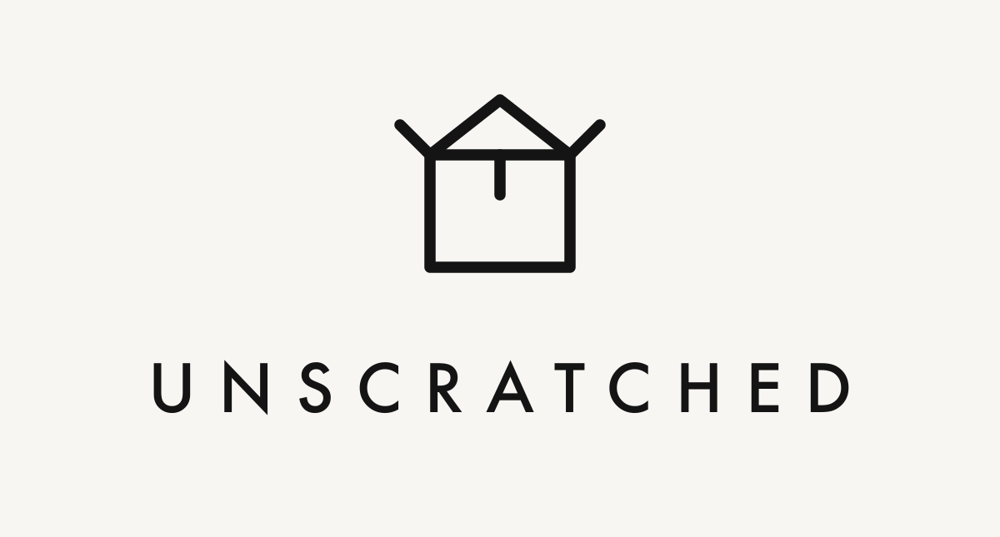

<h1 align="center"></h1>

Free iOS and Android app that walks renters through a room-by-room move-in inspection and exports an unwatermarked PDF report.

## Prerequisites

- Node 22 (pinned in `.nvmrc`; run `nvm use` if you use nvm).

## Quick start

```bash
npm ci
npm start              # press i for the iOS simulator, or a for Android
```

Checks: `npm run typecheck`, `npm run lint`, `npm test`.

## Run on a simulator

The camera needs a dev build; Expo Go is UI only.

- iOS: Xcode with an iOS simulator (CocoaPods is installed for you by Expo; it needs a UTF-8 shell, e.g. `export LANG=en_US.UTF-8`).
- Android: Android Studio with an emulator, and JDK 17.

```bash
npm run ios            # expo run:ios
npm run android        # expo run:android
```

`ios/` and `android/` are generated by prebuild on each run and are not committed.

`patches/` holds a `patch-package` fix (applied on install) for an `expo-modules-jsi` build error on Xcode 26.2/26.3 ([expo/expo#52754](https://github.com/expo/expo/issues/52754)); delete it once upstream ships a fix.
